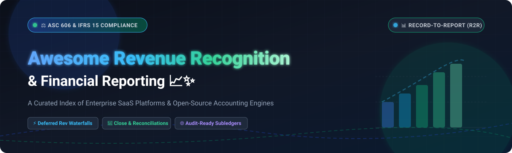

# 📊 Awesome Revenue Recognition & Financial Reporting 📑✨

> **A curated showcase of top Revenue Recognition and Financial Reporting platforms** — spanning enterprise SaaS solutions, record-to-report automation, and open-source engines for automating **ASC 606 / IFRS 15 compliance**, deferred revenue schedules, multi-entity financial close, and board-ready reporting. 🚀
> 
> 🌟 *Star this repository if you find it helpful for your financial architecture, accounting workflows, or software evaluation!* 🌟

---

## 🧭 Table of Contents

- [🌐 Sector Overview & Market Dynamics](#-sector-overview--market-dynamics)
- [🏢 SaaS & Hosted Commercial Platforms](#-saas--hosted-commercial-platforms)
- [💻 Open-Source Software & Accounting Engines](#-open-source-software--accounting-engines)
  - [Open-Source Solutions Overview](#open-source-solutions-overview)
- [📊 Feature Matrix & Comparison at a Glance](#-feature-matrix--comparison-at-a-glance)
- [🤝 Contributing Guidelines](#-contributing-guidelines)
- [📄 License](#-license)

---

## 🌐 Sector Overview & Market Dynamics

The global **Revenue Recognition & Financial Management Software** market is currently estimated at **$25B to $30B**, projected to surpass **$50B+ by 2032** at an annual growth rate (CAGR) of ~13%–14.6%, with specialized automated revenue recognition and compliance subledgers alone accounting for over **$11B**. 

The sector exhibits a **hybrid, moderately consolidated structure at the top**—where a handful of enterprise ERP giants (Workday, Oracle NetSuite, Sage, and SAP) command more than 50% of enterprise market share—coupled with a **fragmented long-tail** of agile point solutions and AI-driven platforms addressing complex multi-element arrangements, dynamic usage-based pricing models, and specialized record-to-report workflows. 📈🔍

---

## 🏢 SaaS & Hosted Commercial Platforms

Below is a comparative breakdown of leading commercial Revenue Recognition and Financial Reporting platforms, sorted by **Company Scale / Valuation (Descending)**.

| Product | Company Scale / Valuation 🏢 | Starting Tier Pricing 🏷️ | Free Tier / Free Trial Limits ⏱️ | Core Capabilities & Primary Focus 🎯 |
| :--- | :--- | :--- | :--- | :--- |
| [**Workday Financial Reporting**](https://www.workday.com/) 📊 | **~$46.5B Market Cap** *(~$10B ARR)* | **$25,000 / year** *(Adaptive Planning entry tier; core ERP custom-quoted PEPM)* | **30-Day Free Trial** *(Adaptive Planning guided sandbox; no free tier for core suite)* | Enterprise financial management with Adaptive Planning, multi-entity consolidation, and advanced revenue recognition. |
| [**NetSuite Financial Reports**](https://www.netsuite.com/) 💼 | **~$9.3B Acquisition** *(By Oracle; ~$40B+ Oracle Cloud Run-Rate)* | **$999 / month** *($11,988/yr base platform + $99/user/month)* | **No Free Tier** *(14-day guided sandbox demo on request; no self-serve free trial)* | Comprehensive ERP financial reporting with Advanced Revenue Management (ARM) module covering ASC 606 / IFRS 15. |
| [**OneStream**](https://www.onestream.com/) 📈 | **~$6.4B Valuation** *(Hg PE buyout; $601.9M ARR)* | **$50,000 / year** *(Entry-level modular subscription for financial close/reporting)* | **No Free Tier** *(No self-serve free trial; guided enterprise proof-of-concept POC only)* | Unified Corporate Performance Management (CPM) for financial close, complex consolidations, and executive reporting. |
| [**Chargebee Finance Reports**](https://www.chargebee.com/) 💳 | **~$3.5B Valuation** *(~$200M–$300M ARR)* | **$599 / month** *(Performance Plan, billed annually; Starter tier free up to limit)* | **Free Tier up to $250k** *(Lifetime cumulative billing free, then 0.75% overage fee)* | Subscription billing-native ASC 606 / IFRS 15 revenue recognition, deferred revenue waterfalls, and GL journal sync. |
| [**BlackLine**](https://www.blackline.com/) 🔒 | **~$2.0B Market Cap** *(~$732M ARR)* | **$13,000 / year** *(Core entry tier for account reconciliations & journal entries)* | **No Free Tier** *(No public free trial; direct sales guided demo environment only)* | Agentic record-to-report (R2R) financial operations platform with AI-driven close, flux analysis, and matching. |
| [**FloQast**](https://floqast.com/) ⚡ | **~$1.6B Valuation** *(Series E; $200M+ ARR)* | **$10,000 / year** *(Close Optimization entry tier platform licensing)* | **No Free Tier** *(No self-serve free trial; guided product walkthrough & ERP sandbox demo)* | Accounting workflow automation, reconciliation management, flux analysis, and fast financial close reporting. |
| [**Sage Intacct Reporting**](https://www.sage.com/en-us/products/sage-intacct/) 📑 | **Parent: ~£10.5B (~$13.5B) Market Cap** *(Sage Group; £2.51B Rev)* | **$9,000 / year** *(~$750–$1,000/month for single-entity core accounting package)* | **No Free Tier** *(30-day interactive test-drive trial via certified VAR partners)* | Cloud financial management with dimensional general ledger reporting, contract billing, and deferred revenue schedules. |

---

## 💻 Open-Source Software & Accounting Engines

Open-source solutions for financial reporting, accounting ledgers, and revenue pipelines sorted by **GitHub Stars (Descending)**.

| Software | GitHub Stars ⭐ | Primary Stack 🛠️ | License 📜 | Self-Hosted 🏠 | Focus & Capabilities 🎯 |
| :--- | :--- | :--- | :--- | :--- | :--- |
| [**Odoo**](https://github.com/odoo/odoo) 🌐 |  | Python / JavaScript / PostgreSQL | LGPL-3.0 | ✅ | Extensible ERP suite with multi-currency ledgers, deferred expense/revenue schedules, and balance sheet reporting. |
| [**ERPNext**](https://github.com/frappe/erpnext) 📦 |  | Python / Frappe / MariaDB | GPL-3.0 | ✅ | Complete open-source ERP with native deferred revenue recognition, general ledger, and P&L / Cash Flow statements. |
| [**Firefly III**](https://github.com/firefly-iii/firefly-iii) 💸 |  | PHP / Laravel / MySQL | AGPL-3.0 | ✅ | Self-hosted double-entry financial management platform with extensive transaction reporting and budget audits. |
| [**Eigent**](https://github.com/eigent-ai/eigent) 🤖 |  | Python / CAMEL Multi-Agent | Apache-2.0 | ✅ | Open-source agentic desktop platform automating financial data extraction, ERP reconciliation, and reporting prep. |
| [**Lago**](https://github.com/getlago/lago) 🌊 |  | Ruby on Rails / Go / PostgreSQL | AGPL-3.0 | ✅ | Open-source metering and usage-based billing infrastructure powering contract revenue calculations and schedules. |
| [**Invoice Ninja**](https://github.com/invoiceninja/invoiceninja) 🧾 |  | PHP / Laravel / Flutter | AGPL-3.0 | ✅ | Open-source billing, invoicing, and revenue tracking platform with multi-currency support and payment reconciliation. |
| [**Ledger CLI**](https://github.com/ledger/ledger) 🧮 |  | C++ / CLI | BSD-3-Clause | ✅ | Gold standard plain-text double-entry accounting system with ultra-fast financial report generation and balance queries. |
| [**ezBookkeeping**](https://github.com/mayswind/ezbookkeeping) 📒 |  | Go / Vue.js / SQLite / MySQL | MIT | ✅ | Lightweight, self-hosted multi-currency financial bookkeeping tool with graphical analytics and balance sheet exports. |
| [**Kill Bill**](https://github.com/killbill/killbill) ⚡ |  | Java / MySQL / PostgreSQL | Apache-2.0 | ✅ | Open-source enterprise billing and subscription platform with payment state-machine management and revenue audit logging. |
| [**Frappe Books**](https://github.com/frappe/books) 📚 |  | Electron / Vue / SQLite | AGPL-3.0 | ✅ (Desktop) | Privacy-friendly desktop accounting software for small businesses with automated P&L, balance sheets, and ledgers. |
| [**LedgerSMB**](https://github.com/ledgersmb/LedgerSMB) 🏛️ |  | Perl / PostgreSQL | GPL-2.0 | ✅ | Battle-tested double-entry accounting and ERP suite providing full general ledger, trial balance, and tax reporting. |
| [**eRev**](https://github.com/ChipmunkRPA/eRev) 📐 |  | Python / SQLite | Freeware / Open Tier | ✅ (Desktop) | Purpose-built desktop revenue recognition subledger engineered specifically for local ASC 606 & IFRS 15 allocation. |
| [**Shillinq**](https://github.com/ConductionNL/shillinq) 📂 |  | PHP / Nextcloud / Docker | EUPL-1.2 | ✅ | Nextcloud-integrated business administration suite with contract lifecycle tracking, double-entry bookkeeping, and VAT. |

---

### Open-Source Solutions Overview

#### 1. [Odoo](https://github.com/odoo/odoo) 🌐
- **Stack:** Python, JavaScript, PostgreSQL | **License:** LGPL-3.0
- **Overview:** A globally adopted open-source ERP framework with robust financial management modules. Supports multi-currency ledger structures, deferred revenue journal generation, bank reconciliation, and customizable P&L/balance sheet reporting.

#### 2. [ERPNext](https://github.com/frappe/erpnext) 📦
- **Stack:** Python, Frappe Framework, MariaDB | **License:** GPL-3.0
- **Overview:** Fully fledged open-source ERP featuring native deferred revenue recognition out-of-the-box. Supports milestone and subscription revenue amortizations, multi-company financial consolidation, fixed asset registers, and comprehensive audit trails.

#### 3. [Firefly III](https://github.com/firefly-iii/firefly-iii) 💸
- **Stack:** PHP (Laravel), MySQL/PostgreSQL | **License:** AGPL-3.0
- **Overview:** A secure, self-hosted financial manager supporting double-entry accounting principles. Delivers comprehensive financial reporting, cash flow analysis, budget tracking, and automated rule engines.

#### 4. [Eigent](https://github.com/eigent-ai/eigent) 🤖
- **Stack:** Python, Multi-Agent Architecture | **License:** Apache-2.0
- **Overview:** An open-source agentic platform tailored for finance teams. Connects into ERP systems to extract transaction records, perform cross-system reconciliations, and generate draft variance and board reports.

#### 5. [Lago](https://github.com/getlago/lago) 🌊
- **Stack:** Ruby on Rails, Go, PostgreSQL | **License:** AGPL-3.0
- **Overview:** An open-source billing and real-time metering engine designed to manage complex consumption models. Provides exact contract usage metrics, minimum spends, and prepaid revenue allocations feeding downstream ASC 606 subledgers.

#### 6. [Invoice Ninja](https://github.com/invoiceninja/invoiceninja) 🧾
- **Stack:** PHP (Laravel), Flutter | **License:** AGPL-3.0
- **Overview:** Self-hosted invoicing, payments, and revenue tracking engine for SMBs and enterprises. Includes automated payment reminders, multi-currency reporting, and transaction reconciliation.

#### 7. [Ledger CLI](https://github.com/ledger/ledger) 🧮
- **Stack:** C++, Command-Line Interface | **License:** BSD-3-Clause
- **Overview:** The pioneering plain-text accounting ledger engine. Capable of processing thousands of journal transactions in milliseconds to generate balance sheets, register reports, and revenue summaries without external database overhead.

#### 8. [ezBookkeeping](https://github.com/mayswind/ezbookkeeping) 📒
- **Stack:** Go, Vue.js, SQLite/MySQL | **License:** MIT
- **Overview:** Lightweight and intuitive self-hosted bookkeeping application with support for multiple accounts, transaction tags, interactive financial dashboards, and CSV/Excel ledger exports.

#### 9. [Kill Bill](https://github.com/killbill/killbill) ⚡
- **Stack:** Java, MySQL/PostgreSQL | **License:** Apache-2.0
- **Overview:** Industrial-grade subscription billing and payment routing platform. Tracks subscription lifecycles, billing invoices, and payment states to ensure clean record-keeping for downstream revenue recognition.

#### 10. [Frappe Books](https://github.com/frappe/books) 📚
- **Stack:** Electron, Vue.js, SQLite | **License:** AGPL-3.0
- **Overview:** Free, modern, and local-first desktop accounting software for freelancers and small businesses. Delivers double-entry bookkeeping, invoicing, P&L reporting, and balance sheets.

#### 11. [LedgerSMB](https://github.com/ledgersmb/LedgerSMB) 🏛️
- **Stack:** Perl, PostgreSQL | **License:** GPL-2.0
- **Overview:** Long-standing open-source ERP and accounting system providing trial balances, general ledger audit reports, inventory tracking, and sales order processing.

#### 12. [eRev](https://github.com/ChipmunkRPA/eRev) 📐
- **Stack:** Python, SQLite | **License:** Freeware / Open Tier
- **Overview:** Dedicated local desktop tool engineered specifically for ASC 606 / IFRS 15 multi-element contract allocations, deferred revenue waterfalls, and offline accounting privacy.

#### 13. [Shillinq](https://github.com/ConductionNL/shillinq) 📂
- **Stack:** PHP, Nextcloud | **License:** EUPL-1.2
- **Overview:** Nextcloud app suite uniting contract lifecycle management, double-entry bookkeeping, VAT calculations, and standardized European SBR/XBRL reporting.

---

## 📊 Feature Matrix & Comparison at a Glance

| Platform / Tool | Type | ASC 606 / IFRS 15 Engine ⚖️ | Financial Statements (P&L/BS/CF) 📑 | Multi-Currency Support 💱 | Self-Hosted 🏠 | Target Use Case 🎯 |
| :--- | :--- | :---: | :---: | :---: | :---: | :--- |
| **Workday** 📊 | Enterprise SaaS | ✅ Comprehensive | ✅ Native + Adaptive | ✅ Advanced | ❌ | Large enterprises requiring unified HCM, ERP & FP&A. |
| **NetSuite** 💼 | Enterprise SaaS | ✅ Advanced (ARM) | ✅ Comprehensive | ✅ Advanced | ❌ | Mid-to-large businesses wanting full ERP-integrated RevRec. |
| **OneStream** 📈 | Enterprise SaaS | ✅ Via Rules/Schedules | ✅ Advanced Consolidation | ✅ Advanced | ❌ | Complex multi-entity consolidations & corporate reporting. |
| **Chargebee** 💳 | SaaS Billing | ✅ Native Subledger | ✅ Revenue Waterfalls | ✅ Multi-Gateway | ❌ | High-growth subscription & SaaS recurring revenue models. |
| **BlackLine** 🔒 | Enterprise SaaS | ⚠️ Close Reconciliations | ✅ Record-to-Report | ✅ Advanced | ❌ | Enterprise financial close, balance matching & journal prep. |
| **FloQast** ⚡ | Mid-Market SaaS | ⚠️ Close Flux Analysis | ✅ Close Management | ✅ Native | ❌ | Fast close cycles, balance sheet reconciliations & audit prep. |
| **Sage Intacct** 📑 | Mid-Market SaaS | ✅ Rev Schedules | ✅ Multi-Dimensional | ✅ Native | ❌ | Mid-market businesses seeking dimensional financial reporting. |
| **Odoo** 🌐 | Open-Source ERP | ⚠️ Deferred Journals | ✅ Full Statements | ✅ Multi-Currency | ✅ | Scalable business operations with modular accounting apps. |
| **ERPNext** 📦 | Open-Source ERP | ✅ Deferred Recognition | ✅ Full Statements | ✅ Multi-Currency | ✅ | End-to-end open ERP with out-of-the-box deferred revenue. |
| **Firefly III** 💸 | Open-Source Tool | ❌ | ✅ Cash Flow & Reports | ✅ Multi-Currency | ✅ | Self-hosted financial management and expense analytics. |
| **Eigent** 🤖 | Open-Source Agent | ❌ | ✅ Automated Reports | ⚠️ Via ERP Sync | ✅ | AI-assisted variance reports, audit prep & reconciliation. |
| **Lago** 🌊 | Open-Source Billing | ⚠️ Usage Metering | ⚠️ Invoicing Analytics | ✅ Multi-Currency | ✅ | Developer-first usage & subscription billing infrastructure. |
| **Invoice Ninja** 🧾 | Open-Source App | ❌ | ✅ Sales & Cash Reports | ✅ Multi-Currency | ✅ | Self-hosted invoicing, payments, and client management. |
| **Ledger CLI** 🧮 | Open-Source CLI | ❌ | ✅ Command-Line Ledger | ✅ Arbitrary | ✅ | Developers and technical accountants desiring plain-text ledgers. |
| **ezBookkeeping** 📒 | Open-Source App | ❌ | ✅ Visual Analytics | ✅ Multi-Currency | ✅ | Clean personal and micro-business double-entry bookkeeping. |
| **Kill Bill** ⚡ | Open-Source Billing | ⚠️ Subscription State | ⚠️ Billing Subledger | ✅ Multi-Currency | ✅ | High-volume recurring billing and subscription engines. |
| **Frappe Books** 📚 | Open-Source Desktop | ❌ | ✅ P&L / Balance Sheet | ✅ Multi-Currency | ✅ (Local) | Offline desktop accounting for micro-businesses & freelancers. |
| **LedgerSMB** 🏛️ | Open-Source ERP | ⚠️ Standard Amortization | ✅ General Ledger / P&L | ✅ Multi-Currency | ✅ | SMB order-to-cash, inventory, and double-entry accounting. |
| **eRev** 📐 | Free / Open Desktop | ✅ Dedicated Allocator | ⚠️ Rev Waterfalls Only | ✅ Multi-Currency | ✅ (Local) | Solo CPAs & SMB accountants calculating ASC 606 allocations. |
| **Shillinq** 📂 | Open-Source Suite | ⚠️ Contract-Linked | ✅ Core Financials | ✅ Multi-Currency | ✅ | Organizations using Nextcloud for contract & finance administration. |

---

## 🤝 Contributing Guidelines

Contributions, feedback, and suggestions are warmly encouraged! 🎉

If you know of a production-grade open-source or commercial financial reporting / revenue recognition platform that belongs here, please submit a Pull Request following these steps:

1. **Fork the repository** 🍴
2. **Add the project details** to the relevant table and descriptions:
   - Tool Name, Link, and Logo/Emoji
   - GitHub Stars Badge (social style, white color, linking to stargazers)
   - Technology Stack and License
   - Accurate starting pricing and exact free tier/trial limits
3. **Ensure strict adherence** to ASC 606, IFRS 15, or general ledger financial reporting relevance.
4. **Submit your Pull Request** with a concise summary of the addition! 🚀

---

## 📄 License

This curated collection is made available under the **Creative Commons Zero v1.0 Universal ([CC0 1.0](https://creativecommons.org/publicdomain/zero/1.0/))** public domain dedication. 

Individual software projects, trademarks, and logos mentioned herein belong to their respective copyright holders and open-source licenses.

---

🌟 **Found this guide valuable? Please give it a star!** 🌟

*Maintained with ❤️ by the open-source accounting community.*

